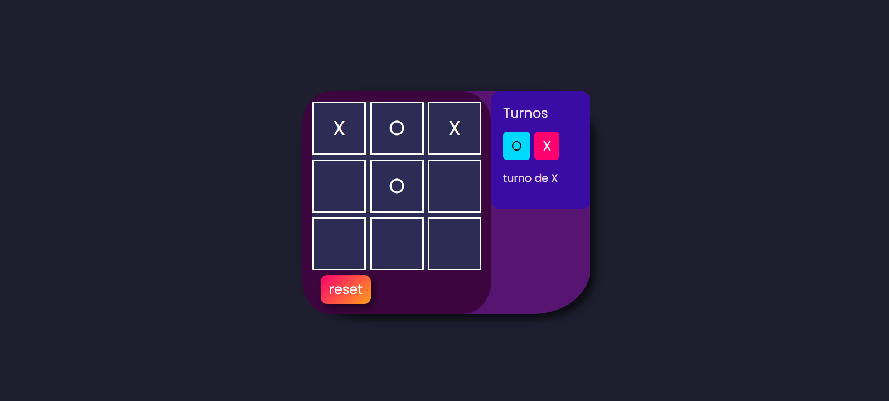
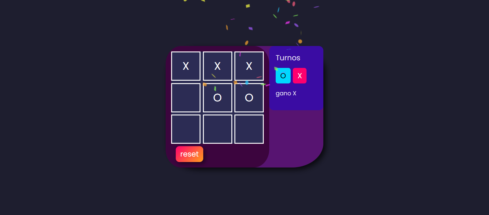
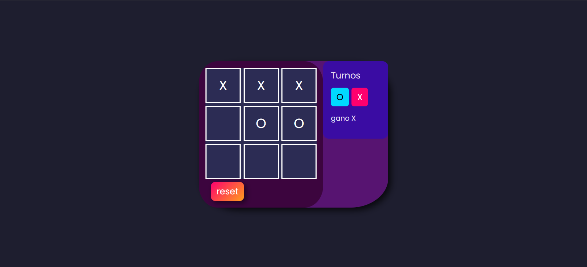
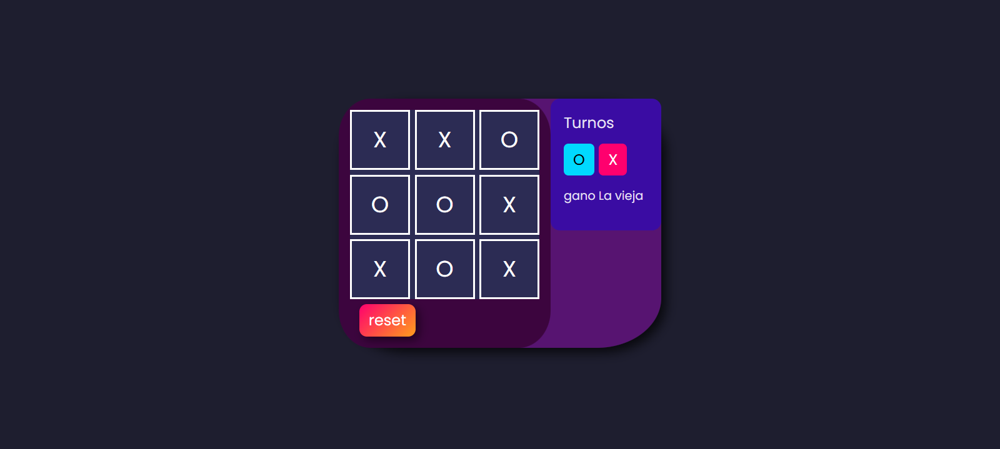

# Tic-Tac-Toe — React

**▶ En vivo: https://jrxjb.github.io/tic-tac-toe-react/**

Clásico tic-tac-toe (3 en línea) para dos jugadores en el navegador. La partida se
guarda en `localStorage`: si recargás la página, el tablero, el turno y el ganador
se mantienen.

## Stack

- **React 19.2** + **Vite 7.2.4**
- **canvas-confetti 1.9.4** (confeti al ganar)
- **ESLint 9** (linter único) · **Node test runner** (`node:test`) para tests

## Por qué lo hice

Proyecto de mi portafolio para practicar estado en React con persistencia real:
separar la lógica del juego de la vista, detectar ganador/empate y que el estado
sobreviva a una recarga. Es también mi primer proyecto con tests unitarios.

## Cómo correrlo

```bash
npm install
npm run dev      # desarrollo → http://localhost:5173/tic-tac-toe-react/
npm test         # 5 tests (lógica pura del juego)
npm run lint     # ESLint
npm run deploy   # build + publica en GitHub Pages (rama gh-pages)
```

## Capturas

| Tablero en juego | Victoria | Recarga tras ganar | Empate |
| :---: | :---: | :---: | :---: |
|  |  |  |  |

Las capturas 2 y 3 son la misma partida: la 3 es después de recargar (F5). El ganador
persiste y el confeti no se vuelve a disparar.

## Decisiones técnicas

- **Estado con `localStorage` e inicializadores lazy** (`useState(() => ...)`) —
  se lee una sola vez al montar, sin render extra.
- **Lógica pura separada en `src/game.js`** (`checkWinner` / `isDraw`), sin React,
  testeable en Node puro → `my-tests.js` con el test runner nativo (5 tests).
- **Detección de ganador por combinaciones** (8 filas/columnas/diagonales).
- **Deploy en GitHub Pages** con `base: '/tic-tac-toe-react/'` en `vite.config.js`
  y rama `gh-pages` (`npm run deploy`).
