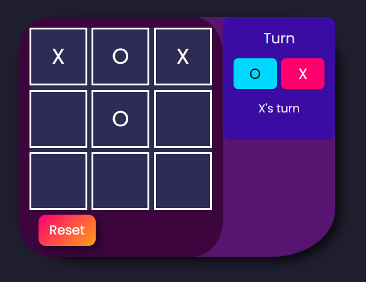
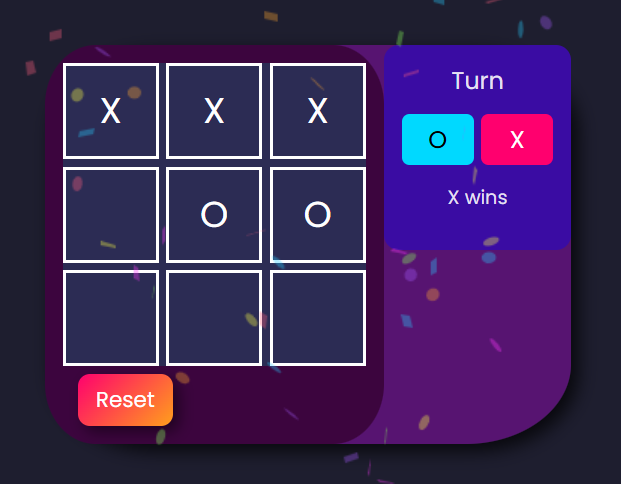
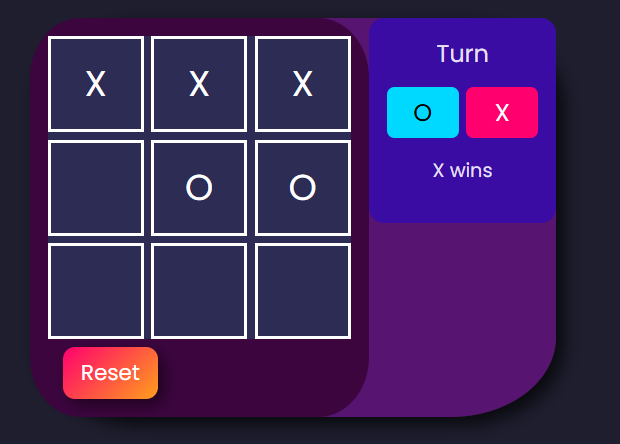

# Tic-Tac-Toe — React

**▶ Live: https://jrxjb.github.io/tic-tac-toe-react/**

Classic two-player tic-tac-toe in the browser. The game is saved to `localStorage`:
reload the page and the board, the turn and the winner are still there.

## Stack

- **React 19.2** + **Vite 7.2.4**
- **canvas-confetti 1.9.4** (confetti on win)
- **ESLint 9** (single linter) · **Node test runner** (`node:test`) for tests

## Why I built it

A portfolio project to practise React state with real persistence: keeping the game
logic separate from the view, detecting a winner/draw, and making the state survive a
reload. It is also my first project with unit tests.

## Getting started

```bash
npm install
npm run dev      # dev server → http://localhost:5173/tic-tac-toe-react/
npm test         # 5 tests (pure game logic)
npm run lint     # ESLint
npm run deploy   # build + publish to GitHub Pages (gh-pages branch)
```

## Screenshots
| Game in progress | Win | Reload after winning | Draw |
| :---: | :---: | :---: | :---: |
|  |  |  |  |

Screenshots 2 and 3 are the same game: 3 is after a reload (F5). The winner persists
and the confetti does not fire again.

## Technical decisions
- **State with `localStorage` and lazy initializers** (`useState(() => ...)`) —
  read once on mount, no extra render.
- **Pure logic separated in `src/game.js`** (`checkWinner` / `isDraw`), no React,
  testable in plain Node → `my-tests.js` with the native test runner (5 tests).
- **Winner detection by combinations** (8 rows/columns/diagonals).
- **Deploy to GitHub Pages** with `base: '/tic-tac-toe-react/'` in `vite.config.js`
  and a `gh-pages` branch (`npm run deploy`).
- **Auto-translate blocked on purpose**: `<div id="root" translate="no">` + `lang="en"`.

## License

MIT — see [LICENSE](./LICENSE).